# Architecture

This document maps repository ownership, application state transitions, and data-flow contracts. Start with [`README.md`](../README.md) for setup and operator-facing behavior. Development rules, verification requirements, and PR procedures live in [`CONTRIBUTING.md`](../CONTRIBUTING.md); detailed contracts are in [analysis coordination](analysis-coordination.md), [participation](participation.md), [sessions](session.md) and [recovery decisions](recovery.md). Agent skills select these same references. Source paths are relative to `apps/web` unless explicitly marked as workspace-root paths; pnpm commands run from the workspace root.

## Ownership boundaries

| Area | Responsibility |
| --- | --- |
| `src/proxy.ts` | Request ID normalization/forwarding and disabled debug-route rejection before rendering |
| `src/app/**` | Next.js routes, route handlers, layouts, and React Server Components |
| `src/features/**` | Feature-owned UI, orchestration, actions, services, schemas, helpers, and nearby tests |
| `src/features/app-context/**` | App-flow contracts, client orchestration, and server-owned `StepState` transitions |
| `src/features/session/**` | Shared browser session admission, on-demand state checks and guarded business operations; no tab ownership |
| `src/lib/**` | Shared infrastructure, framework adapters, and repository-wide helpers |
| `@aerpp/config/server/web` | Server-only runtime environment parsing, defaults and validation |
| `src/lib/external/**` | Read-only copies of externally provided files |
| `src/ui/**` | Presentation-only components reused across features |
| Workspace-root `config/common/llm/**` | LLM runtime configuration and model license notices |
| Workspace-root `config/common/survey/**` | Web questionnaire sources, independent of environment; Admin research ZIPs read archived definitions |
| `assets-public/**` | Tracked MDX/PDF publication inputs, browser tests and screenshots; fresh-clone source builds |
| `assets/**` | Git-ignored MDX/PDF operational inputs; preferred by local development/builds and required by test/production distribution images |
| `packages/documents/fonts/**` (workspace root) | Shared font used by Web and Admin PDF rendering |
| Root `docs/licenses/npm-notices.json` | Shared dependency notices generated by root `pnpm run license` and rendered on `/license` |
| `public/**` | Static assets such as manifest PNG icons; the manifest itself is `src/app/manifest.json` |
| `docs/**` | Web architecture, behavior and contributor references |
| Root `generated/**` and `private/**` | Private runtime files, deployment evidence, Terraform state caches and operator credentials; follow [private artifact retention](../../../docs/development.md#private-artifact-retention) before cleanup |
| `scripts/**` | Local operational, validation, build, and maintenance tools |

Source dependencies normally flow from `src/app/**` to `src/features/**` to `src/lib/**`, with features also consuming `src/ui/**`. `src/lib/**` must not import application or presentation areas.

Code stays in its owning feature when it primarily changes with that feature. Multiple consumers alone are not a reason to move feature-owned code into `src/lib/**`. Repository-authored adapters around external copies belong in the owning feature or another clearly named `src/lib/**` module; the external copy itself is not modified.

Shared action buttons live in `src/ui/action-button.tsx`; callers own pending state and supply the pending label. Intro navigation and starting another analysis share UI workflow hooks under `src/features/home-flow/`, while `AppContext` continues to own transitions and persistence. Debug snapshot rendering stays within `src/features/debug/`.

`AppContext` also retains the consent email and checkbox draft in tab-local React state so visiting auxiliary routes does not discard unfinished consent input. The UI draft is not written to browser storage, cookies, logs, or debug snapshots. Transitions out of the pre-consent business state and explicit client-state clearing discard it; rejected transitions retain it. A full reload or closing the tab discards this in-memory draft. Separately, consent preparation persists the sealed request, including its email, in sealed browser IndexedDB for identical retries; this does not restore checked consent boxes after reload.

The document editor likewise keeps its text, names, selected tab, and imported filenames in `AppContext` memory. `useDocumentEditor` owns editing, parsing, and tab behavior; `document-draft.ts` owns pure grapheme counting, analysis-readiness checks and draft restoration from an analysis job. The shared provider retains the draft across route unmounts. The draft remains in memory through analysis, result viewing and survey submission until explicit deletion, withdrawal or reset; the analysis job also carries submitted input through failure recovery. The draft records which analysis job it restored, so revisiting an auxiliary route cannot replay that job over subsequent edits. Reset clears the draft, and draft updates outside the document step are ignored. No document draft is persisted to browser storage, cookies, server storage, logs, or debug snapshots.

`AppShell` is the server component that loads initial session state and composes shared providers, messages, `AppHeader`, and `AppFooter`. `MainContentLayout` owns only the main content markup and spacing.

`AppFooter` hosts the collapsed administrator recovery disclosure. Its workflow stays in `src/features/home-flow/admin-recovery-control.tsx`, reuses the guarded AppContext transition, and returns auxiliary routes to the home consent screen after successful recovery preparation.

The app shell's `RouteFocusBoundary` reveals and focuses the first visible content heading with a `tabindex` after ordinary pathname navigation, waiting for delayed route content when necessary. This excludes the progress navigation's non-focusable heading. It uses immediate scrolling so an earlier smooth scroll cannot hide the newly focused heading. It leaves initial load, fragment targets, and browser Back/Forward scrolling to Next.js and the browser. `HomeFlow` continues to own focus between steps within the home route. Both cancel their pending focus work when superseded or unmounted.

Shared blue text uses `--brand-text`, with separate light/dark values for legibility. Decorative backgrounds and borders continue to use `--brand-blue`; primary-button backgrounds are set separately to preserve white-text contrast. Document tab lists contain only tab controls, and the full application license has a labeled, keyboard-focusable scroll region.

## App flow ownership

The StepState workflow deliberately remains readable through a small number of files:

- `actions-step-state.ts` is the client-callable, intent-only Server Action boundary, including consent email, authentication preparation, and withdrawal.
- `step-state-transition-service.ts` contains the complete flow-ordered intent rules and their external side effects.
- `step-state-transition-core.ts` contains shared session, guard, validation, persistence, and logging mechanics.
- `step-state-validation.ts` defines valid persisted stage/root-step combinations.
- `step-state-session.ts` reads and normalizes initial state without mutating cookies during Server Component rendering. Admission and mutating intents own persistence.
- `app-context-provider.tsx` owns browser-side orchestration and adopts server-approved states. Result/questionnaire navigation returns a tab-local view without saving a shared screen transition.

Do not split the transition service by individual intent. A further split is justified only if a group of transitions gains genuinely independent ownership and can be understood without repeatedly crossing module boundaries.

## StepState transition map

```mermaid
stateDiagram-v2
  [*] --> Start
  Start --> Explanation: moveToExplanation
  Explanation --> Consent: moveToConsent
  Consent --> Consent: prepareConsentContext (save retry request)
  Consent --> Auth: sendConsentEmailAndMoveToAuth
  Auth --> Document: confirmAuthenticationAndPrepareAnalysis
  Auth --> Survey: confirmAuthenticationAndPrepareAnalysis (reviewed initial-survey recovery)
  Auth --> Consent: correctConsentEmail
  Document --> Result: startAnalysis
  Result --> Document: cancelAnalysis / failAnalysis / prepareNewAnalysis
  Result --> Survey: startSurvey
  Survey --> Result: returnToResult
  Survey --> Thanks: completeSurveySubmission
  Thanks --> Result: returnToResult (view only)
  Survey --> Document: prepareNewAnalysis
  Thanks --> Document: prepareNewAnalysis
  Document --> Withdrawn: completeWithdrawal
  Result --> Document: recoverUnavailableAnalysis (eligible output loss; Support confirms)
  Result --> Withdrawn: completeWithdrawal
  Survey --> Withdrawn: completeWithdrawal
  Thanks --> Withdrawn: completeWithdrawal
  Withdrawn --> Withdrawn: completeWithdrawal (retry cleanup)
  Auth --> Auth: resendConsentEmail (same request and deadline)
  Withdrawn --> Start: explicit /reset (new session)
```

This map shows the participant-facing flow, not an unconditional table of persisted writes. `startSurvey` and `returnToResult` validate the session and return the requested view without saving a shared root step; survey entry additionally validates the completed analysis and rejects an already submitted result. Submission status remains in `submittedAnalysisId`, independent of the displayed screen.

`Document`, `Result`, `Survey`, and `Thanks` may use either the `authenticated` or `follow_up` stage. The first successful survey submission moves the stage to `follow_up`; it records accepted initial answers, not completion of the currently displayed analysis. The progress indicator is shown only before follow-up participation and follows the current root step. In `follow_up`, show the repeat-analysis guidance without the step list or an all-complete status, using the authoritative participation mode. Email confirmation resolves the stage from the required `questionnaireKind` returned by Support authentication, with no count query. Each analysis start obtains the authoritative kind from the same Support transaction that records the attempt and acquires the initial claim; Web persists and displays that kind before inference. The earlier readiness authentication check does not determine questionnaire eligibility; the start transaction remains authoritative. A completed initial result must receive its initial questionnaire before ordinary new-analysis preparation; an uncertain submission blocks ordinary deletion until reconciled. Persisted `authenticated/thanks` is accepted by the state validator, but normal survey completion produces `follow_up/thanks`, and preparing another analysis from `Thanks` requires that follow-up stage. Without a browser result, that intent additionally requires a valid completed-analysis ID and a matching `submittedAnalysisId` in the current server session. Ordinary `resetFlow` remains guarded. The `/reset` button is a separate force-recovery path from any state, including withdrawal, and creates a new session generation.

The direct transition table is exercised through `actions-step-state.test.ts`. `step-state-validation.test.ts` checks the complete stage/root-step matrix so adding a new enum value cannot silently create an unreviewed persisted state.

## Data flow and persistence

### Session and Client Persistence

Each browser shares one SessionID across tabs. Local SQLite owns allowlisted business metadata, revision/hash, credential digest and operation fences. The HttpOnly credential authenticates requests; SessionID and hash alone do not. Private email and fixed retry context remain sealed in browser IndexedDB. Documents stay in browser/job memory, and completed results and frozen answers use separate browser seals. See [the data inventory](../../../docs/data-handling.md#web-and-participant-browser) for storage, encryption and retention by field.

[Session contracts](session.md) own credential issuance, stamp validation, seals and allocation limits. [Shared browser sessions](browser-sessions.md) owns tab-local navigation and response continuation. [Recovery decisions](recovery.md) owns retry, reload, confirmed invalid-session recovery and restart behavior. Debug force reset revokes captured authority before browser cleanup; it does not erase Firestore study eligibility. Production recovery uses a reviewed administrator grant and fresh consent/email confirmation.

### Identifiers

- `PARTICIPANT_API_SERVER_ID` is a deployment/server identifier read from the environment and sent to participant, consent, withdrawal, and survey metadata APIs as `serverId`.
- `clientId` is generated once per session with the `aerpp:cid-` prefix and stored in the allowlisted server session database.
- `pseudonym` is derived from the normalized email address using versioned HMAC-SHA-256 with `IDENTIFIER_HASH_SECRET`, uses the `aerpp:pid-` prefix, and is stored in the allowlisted server session database.
- `consentId` is an unpredictable 20-character alphanumeric ID prepared before email submission and reused as the authentication and confirmed consent record ID. Verification, withdrawal, analysis attempts and survey mutations carry it with the owner fields. It has no application prefix and is not a separate participant identifier.
- `authVerifiedAt` is written only after external authentication verification succeeds and is treated as valid for the lifetime of the session cookie.
- `analysisId` is generated for each admitted LLM attempt with the `aerpp:aid-` prefix, returned in the HTTP 202 response, stored with the sealed analysis result, and submitted with survey metadata and survey answers.
- `documentId` is derived from email, the Japan-time calendar date string, document purpose, document-set SHA-256, and `IDENTIFIER_HASH_SECRET`, uses the `aerpp:did-` prefix, and is embedded in generated consent and withdrawal PDFs. Time-of-day and consent record IDs are not hash inputs; same-day confirmations for the same email, purpose and set share a DID.
- Client/analysis IDs use 32 unbiased random alphanumeric characters. PID/DID use 32 lowercase hexadecimal characters from domain-separated HMAC-SHA-256. The [shared identifier contract](../../../docs/identifiers.md) owns normalization, derivation, alternatives and study freeze requirements.

### Analysis Result Persistence

Inference runs independently of the browser connection. The local Web process holds prompts/output only in RAM; the browser retrieves complete output, finalizes metadata, saves its sealed result and confirms Firestore presentation before display. Word export validates that result and processes its text in the browser. Presentation grants display permission, not proof of viewing.

[Analysis coordination](analysis-coordination.md) owns admission, observation, RAM limits, completion/inference retries, acknowledgement and output-loss recovery. [Recovery decisions](recovery.md#web-process-restart) distinguishes server RAM loss from an available browser result. A presented initial result awaiting answers remains protected; [participation](participation.md#analysis-and-questionnaires) owns the initial/follow-up eligibility boundary.

### Withdrawal cleanup

Withdrawal validates confirmed consent, email, credential and consistency stamp before taking priority over ordinary work. Accepted withdrawal is terminal even if session persistence or cleanup fails. The original sealed request supports exact retries, receipt access and cleanup confirmation; renewed participation requires administrator recovery after cleanup.

[Participation](participation.md#withdrawal-acceptance-and-receipts) owns Web orchestration and UI failure states. [Support persistence](../../support/docs/persistence.md#participation-and-withdrawal) owns pseudonym-wide deletion, retained audit facts and scheduled continuation independently of the browser.

### Survey Submission

Completion metadata and questionnaire answers are separate participant API operations. Normal submission binds the displayed result to the session-owned completed analysis, validates answers against the displayed canonical definition and saves an identical browser retry payload before dispatch. Accepted submission is tracked independently of result/survey navigation. Administrator recovery provides a narrowly authorized initial questionnaire without a result body.

[Participation](participation.md#definition-loading-and-answer-validation) owns definition loading, request shape and answer validation; [submission and identical retries](participation.md#submission-and-identical-retries) owns dispatch, frozen answers and failure handling. [Support persistence](../../support/docs/persistence.md#exact-survey-retries) owns canonical comparisons and first accepted timestamps. [Questionnaire delivery](../../../docs/examples.md#questionnaire-definitions) owns source replacement and archive registration.

### Document Input and Result Rendering

See [document input limits](usage.md#document-input-limits) for the user-facing editor behavior, accepted sizes, and rendering behavior.

- The analysis admission boundary also enforces the code-unit and request-byte ceilings in [`document-constraints.ts`](../src/features/document/document-constraints.ts), in addition to the editor's grapheme/count limits.
- `POST /api/llm/analysis` accepts `{ "documents": [{ "name": "研究計画書", "text": "..." }] }`. Each document must have a name and text. The server validates them and serializes them as JSON in a canonical order, so reordering the same named documents does not change the prompt.
- Document names and text travel together from the editor through the validated analysis API; the server never assigns roles from array positions. The model is instructed to infer document purpose from names and contents, evaluate the documents together, and cite document names. Both names and contents are untrusted data, never instructions.
- PPTX extraction keeps the source text within formatting runs intact, concatenates adjacent runs, and separates paragraphs and explicit breaks with newlines. Formatting alone must not split a number or word in the model input.
- The shared Markdown transform replaces generated images, including reference images, with alt text before both React display and Word HTML conversion.
- Result rendering converts ordinary line endings and literal `\n` / `\r\n` in Markdown text nodes into explicit line breaks, and literal `\t` into tab whitespace, for both the screen and Word exports. Existing Markdown structure, code spans/blocks, and link destinations are preserved. Raw model output, stored output, and analysis metadata retain the original text; conversion also applies when a result is restored.
- The result screen places analysis/storage status directly below its heading. It confirms encrypted browser storage only for a persisted or restored result; animated waiting and pending completion explain that storage is not complete. Word download is optional and independent of automatic browser storage. Submitted results show questionnaire confirmation instead of another invitation. Cleanup guidance stays beside the lower actions, distinguishes initial/follow-up availability, and excludes original files, downloaded files and submitted questionnaires from browser cleanup.

### PDF Downloads

- Explanation and plan PDFs are read from the bundled asset set and returned through the read-only `/api/documents` Route Handler: the selected app-root `assets/` or `assets-public/` files, with private `assets/` required in distribution images.
- Consent and withdrawal PDFs use the selected receipt's own confirmation/acceptance date and pinned document set; default consent selects the session's `consentId`, while history selects an exact owned record. There is no timestamp or current-template fallback. An existing valid session, including withdrawn, can retrieve its owner's history across browsers and participation periods. After session loss, the researcher can reissue. See [document sets](../../../docs/document-sets.md) for storage, immutable retries, v2 DIDs and Admin verification/audit.
- The `/download` page is labelled **同意履歴・関連書類**. Its history read selects the current consent from session authority and returns paired consent/withdrawal summaries containing only fields needed for display; contact and ciphertext are excluded. Incomplete upstream history, missing current evidence, duplicate periods or unmatched withdrawals fail the history read. Exact record IDs select every historical download, including the highlighted current receipts. Current bundled explanation/plan downloads are separate. The [participant guide](usage.md#consent-history-and-related-documents) owns display order, version notices, access conditions and retry behavior.
- Document reads use bounded, uncached `fetch` requests with the existing cookie and tab credential checks; optional downloads do not enter the serialized Server Action dispatcher or adopt session tokens. Historical selection still verifies record ownership. Server-only services share authorization and rendering between current and historical requests.
- Withdrawal receipt generation runs separately after acceptance; a stalled PDF never hides the accepted state, cleanup status or alternate receipt navigation. Download failure does not resubmit withdrawal. The client downloads these PDFs directly from the current screen, so failures are surfaced as in-app status messages instead of relying on a separate browser tab. After leaving the download page, an in-flight download can finish but its response cannot clear or replace the new screen's status. Session-read failures are returned through the same typed failure result. Consent and withdrawal generation share the template-filling process while retaining their event-specific record selection and document IDs. PDF dates use Japan time: consent confirmation and withdrawal acceptance, never download or deletion completion time. Pre-submission screen badges show the current Japan date; they do not assert a recorded event. The required email/date fields are filled and flattened; the final-page footer adds version, plus DID and full SHA-256 only for consent/withdrawal. Supplied asset documents are read-only; explain the confirmation/acceptance date semantics in the surrounding UI and this guide without rewriting the documents.

### Server Logging

`src/proxy.ts` normalizes/generates and forwards `x-request-id`, and rejects disabled debug/reset routes before rendering. It does not read or mutate participant sessions. Web uses `pino` through `src/lib/logger.ts`; [Web logging](logging.md) owns events, allowlisted fields, redaction and dependency diagnostics, under the [workspace logging rules](../../../docs/coding-conventions.md#logging-and-privacy).

## LLM integration

`src/features/llm/**` owns local endpoint validation, generation settings, bounded complete-JSON response parsing, completion checks and cancellation. Communication uses `undici` fetch with a request-scoped Agent and LM Studio's HTTP `POST /v1/responses` endpoint (`stream: false`, `store: false`). No LLM SDK or external LLM provider is used. HTTP preserves per-request `seed` and other generation settings without managing model loading through an SDK.

The required numeric config fields `generation.temperature`, `topP`, `topK`, `repeatPenalty`, and `seed` are sent as `temperature`, `top_p`, `top_k`, `repeat_penalty`, and `seed` on every request. Their defaults and endpoint configuration requirements are documented in [Model Configuration](../README.md#model-configuration).

## Deployment-owned boundaries

The [workspace deployment guide](../../../docs/deployment.md#web-images-and-operational-bundles) owns private image/bundle delivery and matching application versions. [Research asset selection](../../../docs/examples.md#research-assets) owns the complete public/private MDX/PDF sets and their build-time selection; the derived `AERPP_WEB_ASSET_SOURCE` marker keeps PDF reads aligned with compiled MDX. [Repository structure](../../../docs/structure.md#publication-and-build-boundaries) owns Git, package and Docker visibility.

`/license` reads package-local `generated/licenses/` copies staged from the canonical root notices before development, tests and builds. The Dockerfile ships those notices and `docs/licenses/`; trace checks and browser staging preserve them. Keep these public runtime copies separate from private runtime projections and participant data.

[The data inventory](../../../docs/data-handling.md#retention-and-verification-limits) distinguishes application retention from operator-controlled LM Studio, host, mail and cloud copies. Local application checks do not establish those external boundaries.

## Verification

Use the [change-type verification requirements](../CONTRIBUTING.md#before-opening-a-pr) when modifying these boundaries.

### Workspace participant API contracts

Web imports `@aerpp/participant-api-contracts/participant-api` through `workspace:*` from `packages/contracts`. The package exports the original TypeScript contract and OpenAPI file; Next.js transpiles the TypeScript and Vitest consumes the same source. No Web-local contract copy is maintained. Update generated schemas through root `contracts:sync` and verify with `contracts:check`. This source package is intended for workspace consumers with TypeScript support. Images and private bundles are built through the root deployment workflow.

### Session and participation contracts

[Session contracts](session.md) own SQLite authority, cookies, browser seals and fixed retry storage. [Participation](participation.md) owns consent, initial/follow-up eligibility, questionnaire acceptance and withdrawal orchestration. [Support persistence](../../support/docs/persistence.md) owns the corresponding transactions and immutable study facts. Use [recovery decisions](recovery.md) for retry, reload and researcher assistance, and [study operations](../../../docs/study-operations.md#administrator-selected-recovery-destinations) for reviewed destinations.

### Reception cutoff

`features/reception` owns the dedicated closed screen and the outer client boundary. It is independent of persisted `Stage`/`RootStep`: at `support.access.expiresAt`, every participation state and route shows closure without a `start` transition, withdrawal, or storage deletion. Initial rendering after expiry bypasses session hydration and participant providers. Open pages use a server-synchronized remaining-time countdown, cancel tab operations at expiry, unmount active work, and recheck after focus/visibility changes. Sleeping browsers update on resumption. The cutoff is enforced at participation admission/mutation boundaries, Support request headers, and server-side LLM ownership watchers; reading retained session evidence does not expire authentication. Pending work accepted before the cutoff is not rolled back.

The initial countdown is measured after hydration. Receipt-based synchronization only shortens remaining reception time. Participant authority and new browser seals have no application expiration. Admission refreshes a 400-day browser cookie without rotating credentials; browser deletion or retention policies still require renewed authentication. Server reception checks remain authoritative during suspension.

Browser generation checks fence late response/storage writes before delayed storage notifications arrive. Stale actions show reload guidance; there is no periodic awake/status check or cross-tab screen synchronization. Debug reset revokes authority before origin cleanup. Old credential cookies cannot authenticate after revocation.

## Analysis implementation ownership

`features/llm/use-analysis-job.ts` owns browser observation, reconnection, explicit cancellation, failed-analysis recovery and completion retries. `features/home-flow/section-result.tsx` owns result presentation and navigation. Word export is loaded on demand from `features/llm/export-analysis-result.ts` and processes output only in the browser. Analysis Route Handlers own bounded admission, read-only status/result access and background RAM acknowledgement. `features/llm/analysis-readiness.ts` owns bounded checks before admission; it never determines successful admission or retries inference. `features/llm/analysis-job-registry.ts` owns transient content, detached inference, revocation, deadlines and retransmission; `features/llm/request-lm-studio-response.ts` owns stateless JSON requests and complete-response validation. `features/llm/actions-analysis-job.ts` owns guarded retry Server Functions. The app-context recovery intent revalidates unavailable output against the initial-presentation boundary and records loss in Support before returning to preparation. Shared LLM preset validation lives in `@aerpp/config/llm`.

The thin `/api/documents` route delegates to `features/pdf/document-route.ts`; `document-client.ts` validates read responses, and the PDF/history services own authorization and record selection. PDF template reads use `features/pdf/pdf-templates.ts`. Downloads preserve the supplied body while the shared `@aerpp/documents/pdf` renderer adds a version footer; participant PDFs also fill fields and add the record-bound DID and set SHA-256. `pdf-lib` is used only by local PDF validation tooling.

## Durable audit delivery

`src/instrumentation.ts` starts the Node-only LLM audit delivery worker at server
startup, excluding production builds. `src/features/llm/analysis-audit-delivery.ts`
owns the bounded network worker; `src/lib/analysis-audit-store.ts` owns strict
SQLite persistence and leases. `src/lib/session-database.ts` owns only the shared
file location/permissions and database pragmas; session authority retains its own
schemas and authorization logic.

Before normal terminal delivery, Web durably queues only owner IDs, outcome and
end timestamp. The normal request carries the real duration from RAM and removes
its queued notice after valid acknowledgment. After restart, the worker posts only
the audit schema to `recordAnalysisOutcome`; it cannot submit research metadata
or fabricate a duration. Audit-first and normal-first arrivals retain one original
operational receipt. Current ordinary delivery can still save its actual duration;
historical delivery after withdrawal cannot recreate it.

The worker runs every 15 seconds, at most four 10-second requests per pass. A
60-second lease prevents simultaneous workers taking the same record; stale
acknowledgments cannot remove a renewed lease. Retry delay increases from 5 seconds
to 5 minutes. Malformed requests, authorization-scope refusals and conflicts are
retained as blocked records for operator review. The initial 30-second delay lets
the normal request finish first. There is no expiry or eviction; at 10,000 notices,
queue insertion fails visibly and the in-memory terminal remains retryable.

Audit delivery uses the configured server credential independently of reception
admission. It requires the original acknowledged start and original confirmed
consent, even after recovery/withdrawal. Unknown runs, owner conflicts and changed
terminal observations are refused. A crash before durable enqueue or loss of the
retained disk can still leave the outcome unknown; no end event is invented.
See [operations](../../../docs/study-operations.md#retained-web-audit-queue).
