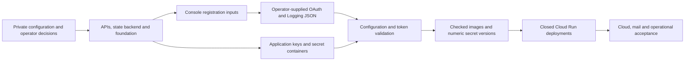

# Environment construction reference

This document explains the required state of an independently constructed environment for people and AI. It describes ownership, relationships and constraints rather than an execution order. [Script-assisted setup](setup.md) owns the supported initial command sequence, [configuration](configuration.md) owns editable fields and runtime projection, and [deployment](deployment.md) owns delivery and recovery.

## Topology and environment boundaries

Web and the local LLM run on the operational machine; Support and Admin run on Cloud Run. Support persists participant authentication and survey records in Firestore and sends mail through the selected Gmail account. Admin reads operational records, manages information and exports research data. The on-premises Fluent Bit logger writes sanitized logs to Cloud Logging. Analysis documents, prompts and results remain on-premises and never enter cloud authentication, surveys, mail or logging.

Test and production have separate projects, credentials, runtime identities, state and acceptance records. The private configuration's `projectId` and `infrastructure.operatorAccount` are authoritative; a global CLI account, `NODE_ENV` or another configuration cannot substitute for them. Operator, Admin login and Gmail sender accounts may differ. See [environment topology](environments.md#intended-environment).

The relationships are dependencies, not evidence of completion. A deterministic service URL can exist before its service; a secret container can exist without a version; a configured backup schedule is not a completed backup.

## Inputs, outputs and authority

| Artifact | Owner and meaning |
| --- | --- |
| `config/<environment>/config.json` | Operator decisions: project, account, locations, study policy, sender and contacts |
| `config/<environment>/secret.json` | Authoritative local secret values and downloaded credential objects |
| `config/common/` | Environment-independent LLM/questionnaire inputs and document version; no credentials or private identifiers |
| `config/<environment>/console-settings.json` | Generated Console links, OAuth URLs and IAM review inputs; never hand-edited |
| `generated/<environment>/auto.json` | Derived/discovered metadata; applied Terraform output has its own protected namespace |
| Terraform state and backend ownership record | Infrastructure ownership, resource bindings and concurrency protection |
| Image, deployment and acceptance records | Immutable artifacts and evidence for the selected environment |
| Generated Logging credential file | Private runtime projection from `secret.json`; not a second editable input |

The [public templates](../config/example/README.md) support independent copy-and-edit construction. The cloud template used by `env:setup init` supplies cloud placeholders, whereas the public example also supports local Web/Support verification. Neither supplies usable cloud credentials. [Output lifecycles](structure.md#private-inputs-generated-outputs-and-retained-state) distinguish reproducible files from retained operational state.

## Project services and state backend

The project must be active, have billing enabled and permit the selected operator to manage the intended resources. The maintained API inventory is [project-services.mjs](../scripts/cloud/project-services.mjs); Gmail API belongs to the selected OAuth client's project. API enablement and backend creation are cloud writes even when followed by a Terraform plan.

The versioned GCS backend is outside the state it stores. Its name binds the environment and project number; its required properties are uniform bucket-level access, enforced public access prevention, the selected location and versioning. Matching private bootstrap evidence establishes ownership. An existing bucket with no matching evidence is not automatically adopted. Backend and provider use the selected operator's gcloud identity; the wrapper's scoped token-refresh connection is temporary and contains no Google refresh token or private key.

## Foundation resources and desired state

| Resource group | Required relationship or invariant |
| --- | --- |
| Firestore | Selected project's native `(default)` database in the explicit immutable location; protected database ownership |
| Firestore indexes/fields | Application query indexes, intended TTL fields and index exemptions defined in the Terraform module; participant state is not TTL-deleted |
| Backups | Optional daily schedule with explicit retention; protected against ordinary deletion/update; completion and restoration need separate evidence |
| Artifact Registry | Separate Admin/Support repositories with retained live/prepared image pins and reviewed cleanup policies |
| Questionnaire archive | Private, versioned, retained bucket with create/view access for the operator and view access for Admin; no overwrite of referenced definitions |
| Document archive | Separate private, versioned, retained bucket for blank PDF/MDX originals and their manifest; operator create/view access and Support/Admin view access; no filled participant documents |
| Service accounts and IAM | Separate hosted Admin, local Admin, Support, Scheduler and Logging identities with scoped grants |
| Secret Manager | Terraform-owned containers and access grants; numeric secret values are prepared outside Terraform |
| Monitoring | Selected email notification destination and Support error policy; delivery acceptance is separate |
| Cloud Run and Scheduler | Created only when accepted deployment inputs exist; excluded from the image-free initial foundation |

The authoritative resource declarations are in [infra/terraform](../infra/terraform/README.md). A manually constructed installation must also establish supported Terraform ownership before using managed deployment scripts; equivalent-looking resources without state/provenance are insufficient. The plan guard rejects unexpected resources, cross-project bindings, destructive changes and unsupported updates. State and resource names are not substitutes for database backups.

## Identity and access boundaries

| Identity | Purpose and access |
| --- | --- |
| Selected operator | Explicit project/account binding for cloud operations and scoped deployment/secret upload permissions |
| Hosted Admin | Firestore data access, Logging reads, questionnaire/document archive reads and access to its four named runtime secrets |
| Local Admin | Keyless impersonation by the selected operator; separate from the hosted identity |
| Support | Firestore participant persistence, document-original archive reads and access to its own runtime secret |
| Scheduler | OIDC calls with the exact maintenance route audience; no participant bearer credential |
| Logging | `roles/logging.logWriter`; operator-supplied key for the on-premises logger |

Google login, the Admin application allowlist, IAM and Cloud Run invocation are separate authorization controls. Firestore IAM does not express every application mutation rule; Admin and Support must preserve their application authorization and transaction boundaries. The generated `accessControl` section is an identity/role review aid, not evidence that grants or log delivery work.

## Credentials and secret values

| Local input | Origin and use |
| --- | --- |
| `IDENTIFIER_HASH_SECRET`, `SESSION_SEAL_PASSWORD` | Stable application keys shared by Web/Admin; preserve alongside the Web coordination volume |
| `NEXTAUTH_SECRET` | Independent Admin session key |
| `SUPPORT_TOKEN_KEY`, `SUPPORT_WEB_API_CREDENTIAL` | Independent Support token/caller keys; Support receives a caller verifier rather than the raw Web credential |
| `ADMIN_GOOGLE_OAUTH_CLIENT_JSON` | Complete downloaded Web application client object, retaining Google's `web` wrapper |
| `SUPPORT_GMAIL_OAUTH_CLIENT_JSON` | Separate complete Web application client object for Gmail, retaining `web` |
| `SUPPORT_GMAIL_REFRESH_TOKEN` | Sender-authorized refresh token for that environment's Gmail client |
| `LOGGING_SERVICE_ACCOUNT_JSON` | Complete service-account JSON with fields directly inside this entry; selected project and Logging identity |

The [canonical secret template](../config/example/secret.json) owns the object shapes. There is no added `json` wrapper. Secret values are not Terraform inputs and never belong in plans/state. OAuth client IDs/secrets are derived from their downloaded objects rather than duplicate editable aliases.

Explicit initial application-key preparation can generate independent 256-bit values for missing/example inputs in an unused installation. Replacement is an explicit action and is rejected for prepared/deployed environments. The three independent Admin values can be uploaded after foundation apply; the OAuth secret is prepared with Admin delivery and Support's complete runtime secret is prepared with Support delivery. Upload receipts reuse unchanged enabled numeric versions without downloading Secret Manager values. The Logging key stays local and is materialized with private permissions for the on-premises runtime. OAuth clients, sender consent and service-account private keys are manual operator inputs.

## OAuth branding and audience

Admin and Gmail use separate Web application clients in the same environment project, sharing the project's branding/audience configuration. The generated client origins/redirects must match registration exactly. Console adds applicable domains when client URIs are saved; the resulting domain list and domains used by homepage/policy URLs still require review. Domain registration and ownership verification are distinct.

The app name, user support email, developer contact, homepage/policy URLs, audience type and publication choices are operator decisions. The application contact address need not be the OAuth support address. Google's [branding requirements](https://support.google.com/cloud/answer/15549049?hl=en) and [verification requirements and exceptions](https://developers.google.com/identity/verification/authentication-verification) describe the relevant constraints; an independently built environment must assess its own audience and use case.

For External OAuth apps in Testing, the Gmail sending account is a Console test user before sender consent. Mail recipients and research participants do not need OAuth test-user registration merely to receive mail. The application's Admin allowlist does not populate that Console list. Gmail authorization requests the sending scope from `support.gmail.requiredScopes`; Console registration alone is not sender consent. Publication status, verification status, token lifetime and actual delivery are separate facts. [Token lifetime](setup.md#oauth-publication-and-token-lifetime) and [reauthorization](deployment.md#gmail-reauthorization) describe operational implications.

## Deployment and acceptance dependencies

Closed Support delivery requires a checked immutable image, matching runtime snapshot and numeric secret version. Opening admission requires accepted data/Scheduler evidence for the same image. Actual mail delivery and confirmation are separate acceptance steps before general participant use. Maintenance work is limited to its configured window; a successful skip outside that window is not completed work. Admin preparation creates a reviewed revision separately from traffic promotion. Web distribution requires the approved private assets, archived image-matching questionnaires/document originals and a checked bundle for the operational Mac.

| Evidence | What it establishes |
| --- | --- |
| Configuration check | Selected consumer's inputs and local project/identity consistency |
| Gmail token check | Token refresh without mail; not delivery or deployed secret binding |
| Terraform plan/apply | Reviewed resource changes and applied state/output; not application acceptance |
| Image/cloud checks | Checked artifact and serving revision/configuration identity |
| Data/Scheduler checks | Actual selected persistence/maintenance behavior within the valid window |
| Real OAuth/mail/Logging/notification acceptance | The separately exercised external path and observed result |
| Operational-machine acceptance | Bundle, browser, local LLM and retained Web state on the intended host |

Test evidence does not establish production readiness. Application production acceptance uses `pnpm run verify:release` plus the selected external/operational checks. The [deployment guide](deployment.md), [environment verification](environments.md#verification-sequence) and [study operations](study-operations.md) own their detailed contracts.

## Script hierarchy

The same boundaries guide independent implementation and repository maintenance. `env:setup` composes phases; it does not implement API, Terraform, credential or deployment protocols. Domain commands own one operation, such as environment projection, secret preparation or an infrastructure action. Focused modules implement project readiness, backend ownership, input projection, saved-plan provenance, output projection and resource-specific plan constraints.

The [script ownership guide](../scripts/README.md#composition-and-operation-layers) maps these layers to source directories. Lower modules do not invoke the setup coordinator or choose a configuration implicitly. App delivery remains with its owning command rather than inside an all-purpose setup script. Plan review, manual credentials, admission opening and real-mail acceptance remain visible boundaries in the [supported procedure](setup.md).
